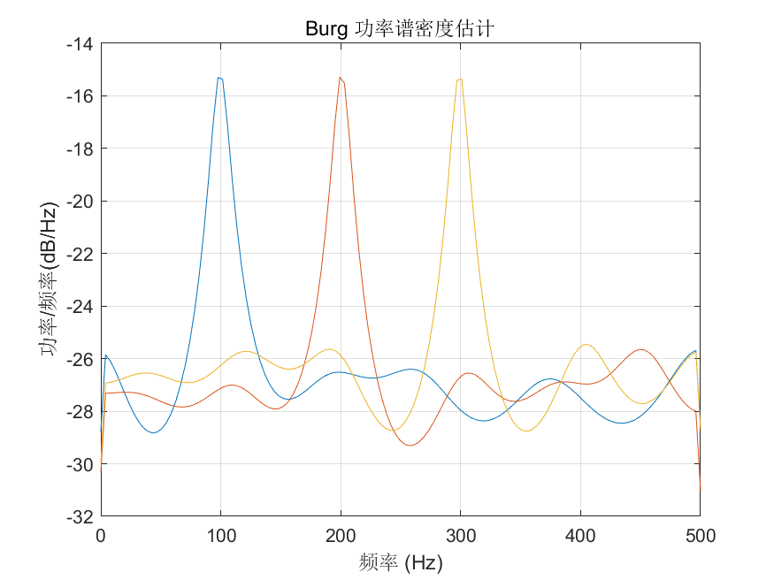

# MATLAB | Spectral Analysis Algorithm | Burg Power Spectrum Density Estimation | Include data and plotting code | Directly Useable

1. Basic Definition
Burg Power Spectral Density Estimation is a spectral estimation method based on linear predictive analysis, which can perform spectral analysis on time-domain signals and obtain the energy distribution of the signal at different frequencies. Burg Power Spectral Density Estimation has high precision and stability and is widely used in signal processing, communication, acoustics, and other fields. The steps for Burg Power Spectral Density Estimation are as follows:
Given a time-domain signal x(n) with a length of N.
By linear predictive analysis, obtain the autoregressive model of the signal: x(n) = ∑(ai * x(n-i)) + e(n) where, ai is the autoregressive coefficient, e(n) is the noise term.
Based on the autoregressive model, obtain the power spectral density estimation value of the signal: P(ω) = σ^2/|1- ∑(ai * exp(-jωi))|^2 where, σ^2 is the noise variance, |.| represents absolute value, j is the imaginary unit, ω is the angular frequency.
By minimizing the mean square error criterion, solve the autoregressive model to obtain the estimated values of the autoregressive coefficients and noise variance. Burg Power Spectral Density Estimation has the advantages of performing high-precision spectral analysis on signals, having good stability and anti-interference ability, and also having good estimation effects on nonlinear components such as harmonics present in signals. However, this method has large computational requirements, and there may be significant delays in real-time processing scenarios.
2. Definition and Outline Effects
The outline effect is as follows:
\n        \n  
Video tutorial operation:
\n        \n          \n          \n          \n          \n            To view this video please enable JavaScript, and consider upgrading to a\n            web browser that\n            supports HTML5 video\n  

## Images

<!-- PAYMENT_BLOCK -->

## Get this dataset

- Payment link (Stripe): [Buy now](https://buy.stripe.com/3cs8yP7sY87d0vu9AB)
- Payment QR code: 

<!-- /PAYMENT_BLOCK -->
